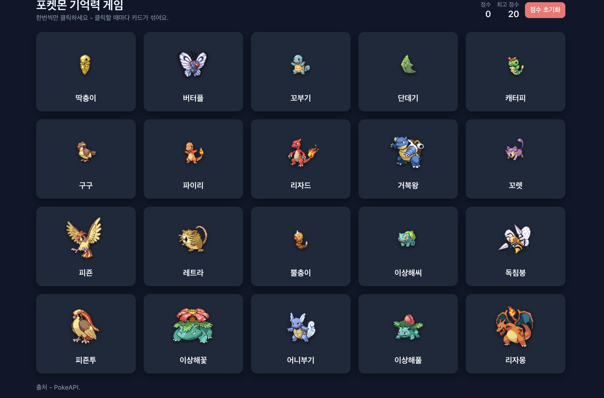

# 김성진 22300118

### Project Information
#### 프로젝트 소개
- PokeAPI 포켓몬 카드를 중복 없이 모두 누르는 기억력 게임
#### 프로젝트 선택 이유
- React 기반 코드 구조 분석과 커스텀 연습에 적합하다고 생각했습니다
#### 원본 GitHub URL과 라이선스
- https://github.com/hencci/memory-card
- MIT

### Installation
#### 설치 및 실행 방법
- git clone -> cd -> npm install -> npm run dev
#### 실행 화면


### Source Code Exploration
#### 주요 파일
- App.jsx : 카드 불러오기, 클릭 및 점수 처리
- Header.jsx : 제목, 점수, 초기화 버튼 표시
- index.css : 전체 디자인 및 카드 배치
#### 컴포넌트
- Card.jsx : 포켓몬 카드 한 장을 보여주고 클릭 시 App에 카드 id 전달
- Modal.jsx : 축하 창, 게임 오버 창 표시
#### 코드 분석
```jsx
data.results.map(async (r) => {
  const parts = r.url.split("/").filter(Boolean);
  const id = parts[parts.length - 1];

  const speciesRes = await fetch(`https://pokeapi.co/api/v2/pokemon-species/${id}`);
  const species = await speciesRes.json();
  const ko = species.names.find((n) => n.language.name === "ko");

  return {
    id: Number(id),
    name: ko ? ko.name : capitalize(r.name),
    image: `https://raw.githubusercontent.com/PokeAPI/sprites/master/sprites/pokemon/${id}.png`,
  };
})
```
- URL에서 포켓몬 번호를 뽑아낸 다음 pokemon-species에 요청하고 await로 기다리고 json()으로 객체로 바꾸고 names 배열에서 한국어 이름을 찾는 코드입니다

### Customizing
#### 수정한 3가지 내용, 수정 파일명 및 전/후 결과
- Text: 문구와 포켓몬 이름 한글화 (Header.jsx, App.jsx, Modal.jsx)
  - 전:
  Oops! You already clicked that card. Game restarts.,
  Bulbasaur
  - 후:
  이런! 이미 클릭한 카드입니다. 게임을 다시 시작합니다.,이상해씨
- Style: 카드 5×4 배열, 이미지 크기 수정 (index.css)
  - 전:
  grid-template-columns: repeat(auto-fit, minmax(140px, 1fr));, width: 72px;
  - 후:
  grid-template-columns: repeat(5, 1fr);, width: 100px;
- UI/Data: 같은 카드를 다시 누르면 게임 오버 창 표시 (App.jsx)
  - 전: 위쪽에 메시지만 표시
  setMessage("Oops! You already clicked that card. Game restarts.");
  - 후: 게임 오버 창 표시
  setShowGameOver(true);

### Deployment
- https://2026oss-assign10.vercel.app/

### Weekly Review
#### 새롭게 배운 내용 3가지
- pokemon-species에서 한글 이름만 가져온 것처럼 API의 여러 주소에서 필요한 정보만 골라 합쳐서 사용할 수 있다는 것을 배웠습니다
- Promise.all로 여러 요청이 모두 끝날 때까지 기다릴 수 있다는 것을 배웠습니다
- 만들어 둔 컴포넌트를 다른 곳에서도 다시 쓸 수 있다는 것을 배웠습니다

#### 어려웠던 점과 해결 방법
- Problem : 계속하기 버튼을 눌러도 창이 닫히지 않는 문제가 발생했습니다
- Solution : Modal.jsx의 onclose를 App.jsx와 같은 onClose로 맞춰서 해결했습니다

#### AI 활용 내용 및 느낀 점
- pokemon-species를 이용한 한글 이름 가져오기 과정에서 AI를 활용했습니다
- 이 과정 중에서 Promise.all의 기능과 async, await, map, fetch의 동작 순서를 잘 알게 되었습니다